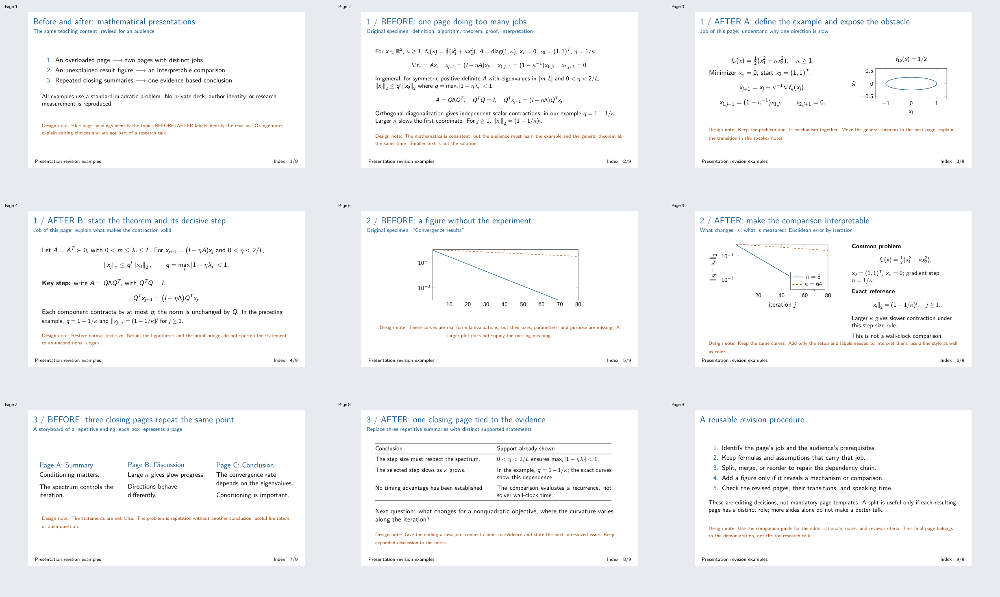

# Before and after: PPT revision examples

这些示例演示如何修改 PPT：拆分过载页面、补足结果图的含义、合并重复的结尾。每组使用同一份标准数学素材，对照修改前后页面并解释编辑理由。数学内容完全独立编写；未复制私人演示文稿、未发表数据、批注、图像或元数据。

- [before-after.md](before-after.md)：三组改前/改后示例。
- [progressive-talk.tex](progressive-talk.tex)：9 页英文 Beamer 修改示例，以标准二次优化为内容载体。
- [progressive-talk.pdf](progressive-talk.pdf)：可直接阅读的观众版本。
- [speaker-notes.zh.md](speaker-notes.zh.md)：中文讲解稿，说明为什么这样修改、何时不应照搬。
- [preview.png](preview.png)：全部页面预览。

## Compile

需要安装包含 Beamer 和 PGFPlots 的 TeX 发行版。在 `examples` 目录运行：

```sh
xelatex -interaction=nonstopmode -halt-on-error -output-directory=../.build progressive-talk.tex
xelatex -interaction=nonstopmode -halt-on-error -output-directory=../.build progressive-talk.tex
```

先创建 `.build` 目录，再将生成的 PDF 复制到 `examples/progressive-talk.pdf`。默认仅编译观众版本；中文讲稿是单独的 Markdown 文件，不嵌入 PDF。图在 TeX 中按显式公式绘制，无需研究数据或下载素材。该示例使用 16:9、11pt 和蓝色，是示例选择，不是技能的硬性要求。

## Interpretation

优化曲线来自精确递推式，不是墙钟时间基准。此处评估的是页面是否更易理解、前后是否有依赖关系、证据是否清楚；不是研究哪种优化算法更好。示例中的橙色编辑说明用于讲解修改方法，不属于正式科研报告。


