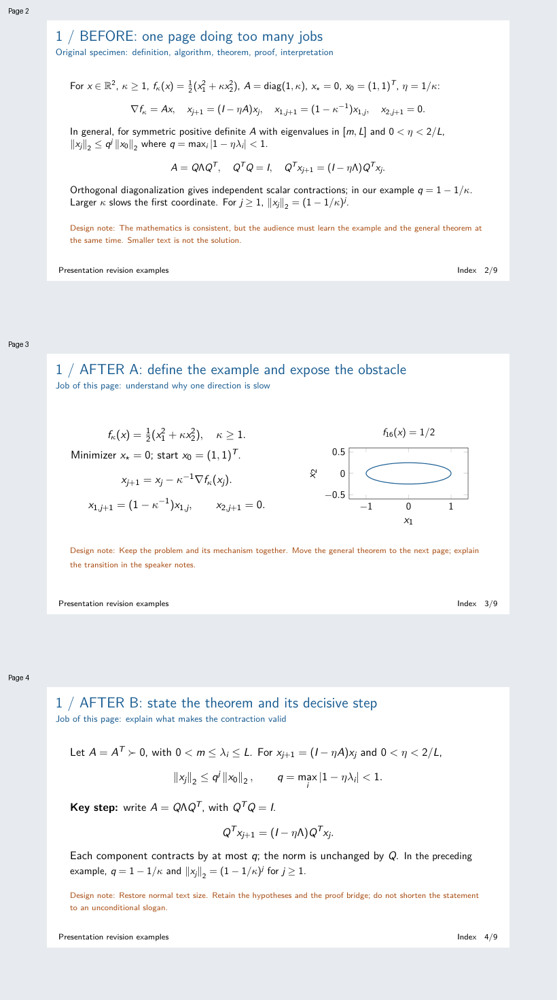
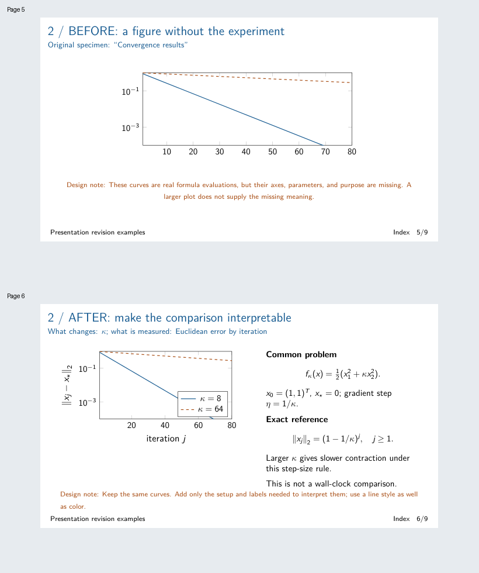
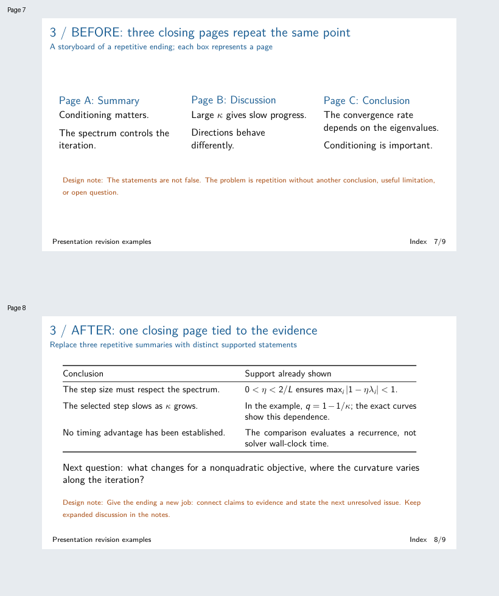

# PPT 修改示例：看得见的编辑决定

这里展示的是**同一数学素材如何变成更好的幻灯片**，不是三个科研问题的讲解。所有内容独立编写；标准二次优化只作为演示载体，没有私人 PPT 或研究数据。

配套 [PDF](progressive-talk.pdf) 共 9 页。橙色 Design note 是示例中的编辑解释，不应照搬到正式科研报告。

## 1. 一页承担太多任务 → 两页有承接关系

**输入：PDF 第 2 页。** 把问题定义、迭代公式、特例分析、一般定理、证明和结论全部挤在同一页。公式本身没有故意写错，问题在于听众必须同时理解例子与一般结论。

**修改：第 3–4 页。** 第一页定义问题、展开两个分量，并用同一目标函数的等值线解释方向差异；第二页再给一般定理，用正交对角化展示关键证明步骤。

**保留与移动：** 保留全部关键假设和公式；把一般结论移到下一页；把转场解释放入讲稿。没有靠缩小字体或删掉假设来腾空间。

**为什么这样改：** 第一页回答“困难在哪里”，第二页回答“为什么这个解释成立”。拆页的依据是逻辑任务，而不是字数阈值。

**检查：** 两页连起来是否保留原有结论？定理里的符号是否先定义？听众是否能说出从例子走向定理的理由？

## 2. 只贴结果图 → 观众能够解释的比较

**输入：PDF 第 5 页。** 曲线没有轴名称、图例，也没有说明哪个参数变化。即使图画得很大，听众也不知道它说明什么。

**修改：第 6 页。** 保持两条曲线不变，添加误差范数、迭代次数、参数图例和线型；旁边给出共同问题、初值、步长规则与精确递推式。

**保留与补充：** 不增加新实验，不挑选更好看的数据。补充的内容只用于识别比较。说明横轴不是秒，避免把收敛曲线误读成计时优势。

**为什么这样改：** 结果页不是图像容器。它应让观众知道改变了什么、测量了什么、结论依据是什么。如果前一页已经完整交代设置，这里可缩成必要的提示，不必重复整套条件。

**检查：** 隐去讲稿后，观众能否独立解释两条曲线的区别？图是否只是重述公式，还是为当前听众提供了必要的直观理解？

## 3. 三页重复结尾 → 一页收束论证

**输入：PDF 第 7 页的页面故事板。** Summary、Discussion、Conclusion 分别重复“条件数影响收敛”，没有引入新的信息。

**修改：第 8 页。** 合并为一页，把结论与已经展示的证据对应，并提出非二次问题中尚未解决的具体问题。

**保留与删减：** 保留数学结论，删除重复措辞；把展开讨论留给讲稿和问答。新增的边界说明来自已有内容：图并没有测量时间。

**为什么这样改：** 结尾应帮助听众明确“已经知道什么、依据是什么、还不知道什么”，不应靠多种标题重复同一信息。

**检查：** 每条结论能否定位到前面的公式或图？新的问题是否由已有局限自然产生？对短报告而言，是否还有必要保留独立结论页？

## 可迁移的部分

可迁移的是判断方式，不是这份示例的页数、表格或二次优化公式。定理、算法、实验和应用报告需要不同结构；只有在页面的任务或前后依赖确实改变时，才拆页、合并或重排。
